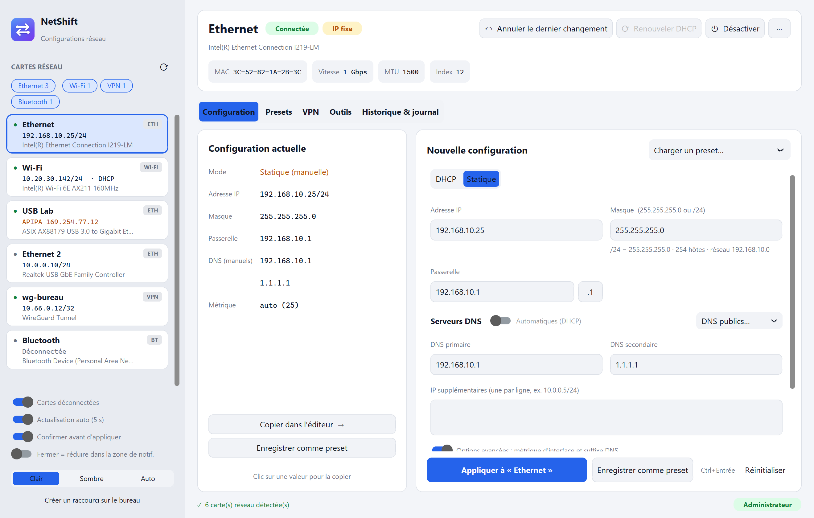

<div align="center">


# NetShift

**Une application Windows moderne pour changer la configuration IP de ses cartes réseau en un clic,
avec des presets, un retour arrière, et les outils réseau du quotidien.**

[](https://github.com/neoguiri/netshift/actions/workflows/ci.yml)
[](https://github.com/neoguiri/netshift/releases/latest)
[](LICENSE)

[Télécharger](https://github.com/neoguiri/netshift/releases/latest) ·
[Fonctionnalités](#fonctionnalités) ·
[FAQ](#faq) ·
[English version](README.md)



</div>

---

Si tu branches régulièrement ton PC sur des réseaux différents (banc de test, switch à configurer,
automate, caméra en `192.168.0.x` d'usine, puis retour au DHCP du bureau), tu connais le parcours
`ncpa.cpl` → *Propriétés* → *IPv4* → *Propriétés*. NetShift le remplace par une seule fenêtre :
choisir la carte, choisir le preset, appliquer. Chaque changement est enregistré pour pouvoir revenir
en arrière immédiatement.

## Fonctionnalités

**Cartes réseau**
- Liste en direct : état (connectée, câble débranché, désactivée), IP, DHCP/fixe, détection APIPA
- Cartes classées par type (Ethernet, Wi-Fi, VPN, Bluetooth, mobile, virtuelles) : chaque type s'affiche ou se masque d'un clic
- Actualisation automatique toutes les 5 s (branchement de câble, nouveau bail DHCP notés au journal)
- Activer / désactiver, renommer, MTU, renouveler / libérer le DHCP

**Configuration**
- Configuration actuelle et nouvelle côte à côte ; clic sur une valeur pour la copier
- DHCP ou IP fixe, masque en `255.255.255.0` **ou** `/24`, passerelle `.1` en un clic, IP secondaires
- DNS manuels même en DHCP, DNS publics en un clic (Cloudflare, Google, Quad9, OpenDNS)
- Options avancées : métrique d'interface (priorité des routes) et suffixe DNS de la connexion
- Validation en direct (adresse réseau/broadcast, passerelle hors sous-réseau, saisie invalide…)
- Résumé avant application, puis ping automatique de la passerelle pour vérifier

**Presets**
- Créer, modifier, dupliquer, réordonner, rechercher, ajouter des notes (site, équipement, VLAN…)
- Carte par défaut par preset (conservée même si l'adaptateur USB est débranché)
- Appliquer n'importe quel preset à n'importe quelle carte ; double-clic = sa carte par défaut (sinon la carte sélectionnée)
- Import / export JSON pour partager avec l'équipe

**VPN**
- Liste des connexions VPN Windows (utilisateur courant et tous les utilisateurs), état et IP en direct
- Créer, modifier, dupliquer, renommer, supprimer : serveur, type de tunnel (IKEv2, SSTP, L2TP/IPsec, PPTP,
  automatique), authentification, chiffrement, clé pré-partagée L2TP, suffixe DNS, split tunneling et ses routes
- Connexion avec les identifiants mémorisés, avec des identifiants saisis pour cette fois, ou via la fenêtre Windows ;
  déconnexion ; explication claire des erreurs `rasdial` courantes (691, 800, 809…)
- Les clients tiers (WireGuard, OpenVPN, AnyConnect, FortiClient…) apparaissent dans les cartes avec le type « VPN »

**Zone de notification**
- Icône avec menu : ouvrir NetShift, **appliquer un preset en deux clics**, état de chaque carte
- Option « fermer = réduire dans la zone de notification » ; notification Windows quand un changement est appliqué

**Historique et retour arrière**
- Chaque changement conserve la configuration précédente
- *Annuler le dernier changement*, *Restaurer l'avant* ou *Réappliquer* ; journal exportable

**Outils réseau** (natifs, sans fenêtre console)
- **Ping** (nombre ou continu, statistiques), **traceroute**
- **Scan réseau** ICMP **et** ARP : trouve aussi les machines qui bloquent le ping, affiche le **fabricant**
  d'après l'adresse MAC (registre IEEE embarqué, sans requête réseau) ; clic droit pour
  pinger, scanner les ports, ouvrir en http(s), RDP ou partages
- **Capture de paquets** : trafic IPv4 en direct sur la carte choisie, filtres façon Wireshark
  (`tcp port 443`, `dns or icmp`, `host 10.0.0.1 not port 22`…), filtres rapides, détail + hexdump,
  statistiques (conversations, machines, protocoles), ouverture de fichiers `.pcap`/`.pcapng`
  (Ethernet, VLAN, ARP, IPv6), export `.pcap` et bouton **Wireshark** lancé directement sur la carte
- **Test de ports TCP**, **DNS** / nslookup / vider le cache, **calculatrice de sous-réseau**, IP publique
- **Commandes système** : `ipconfig /all`, table ARP, routes, connexions, profils Wi-Fi…

## Installation

### Installeur (recommandé)

Télécharge `NetShift-Setup-x.y.z.exe` depuis la [dernière version](https://github.com/neoguiri/netshift/releases/latest) :
raccourci dans le menu Démarrer, raccourci bureau en option, désinstallation propre (*Paramètres → Applications*).
Les presets et l'historique sont dans `%APPDATA%\NetShift` et sont conservés lors des mises à jour.

### Exécutable portable

`NetShift.exe`, dans la même version, se lance sans installation ni Python ; les presets sont alors stockés
dans `data\` à côté de l'exe (fonctionne depuis une clé USB).

Dans les deux cas, Windows demande les droits administrateur au démarrage (nécessaires pour modifier l'IP).

### Depuis les sources

Windows 10/11 et [Python 3.9+](https://www.python.org/downloads/) (cocher *Add to PATH*) :

```bat
git clone https://github.com/neoguiri/netshift.git
cd netshift
"Lancer NetShift.bat"
```

Le lanceur installe les dépendances (CustomTkinter, pystray et Pillow pour l'icône de notification) au premier lancement.
`build_exe.bat` produit `dist\NetShift.exe`, et l'installeur si [Inno Setup 6](https://jrsoftware.org/isdl.php)
est installé.

## Utilisation

| Action | Comment |
|---|---|
| Appliquer une config | Choisir la carte → éditer *Nouvelle configuration* → **Appliquer** (`Ctrl+Entrée`) |
| Partir de la config actuelle | *Copier dans l'éditeur →* |
| Créer un preset | *Enregistrer comme preset* |
| Appliquer un preset | Onglet *Presets* → carte cible → **Appliquer**, ou double-clic |
| Revenir en arrière | **Annuler le dernier changement**, ou onglet *Historique & journal* |
| Actualiser | `F5` ou ⟳ |

Sans droits administrateur, l'application s'ouvre en **lecture seule** et propose de se relancer en admin.

## Fonctionnement

- Lecture des cartes via PowerShell (`Get-NetAdapter`, `Get-NetIPAddress`…) dans un processus persistant
  et masqué : ~3 s la première fois, ~0,25 s ensuite.
- Application via les commandes standard `netsh interface ipv4`, par index d'interface ; les commandes
  exactes apparaissent dans le journal.
- Ping, traceroute et ARP via l'API Windows IP Helper (`IcmpSendEcho`, `SendARP`) : rapide, sans console,
  sans droits admin.
- Aucune télémétrie. Seul le bouton « IP publique » contacte un service externe (`api.ipify.org`).

Détails : [docs/ARCHITECTURE.md](docs/ARCHITECTURE.md).

## FAQ

**Pourquoi les droits administrateur ?** Modifier l'IP, les DNS ou l'état d'une carte est une opération
privilégiée sous Windows. La consultation et les outils fonctionnent sans.

**SmartScreen ou l'antivirus signale l'exe.** L'exécutable est construit par GitHub Actions avec
PyInstaller et n'est pas signé ; ces exe sont parfois signalés à tort. Tu peux lancer depuis les sources.

**IPv6 ?** Pas encore pour la configuration (les adresses IPv6 ne sont pas modifiées).

## Prochainement

- Interface en anglais, configuration IPv6

## Contribuer

Les signalements de bugs, idées et pull requests sont les bienvenus, en français ou en anglais :
voir [CONTRIBUTING.md](CONTRIBUTING.md).

## Licence

[MIT](LICENSE) © neoguiri
