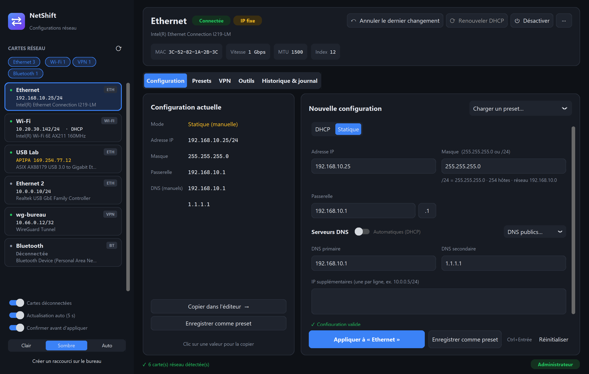
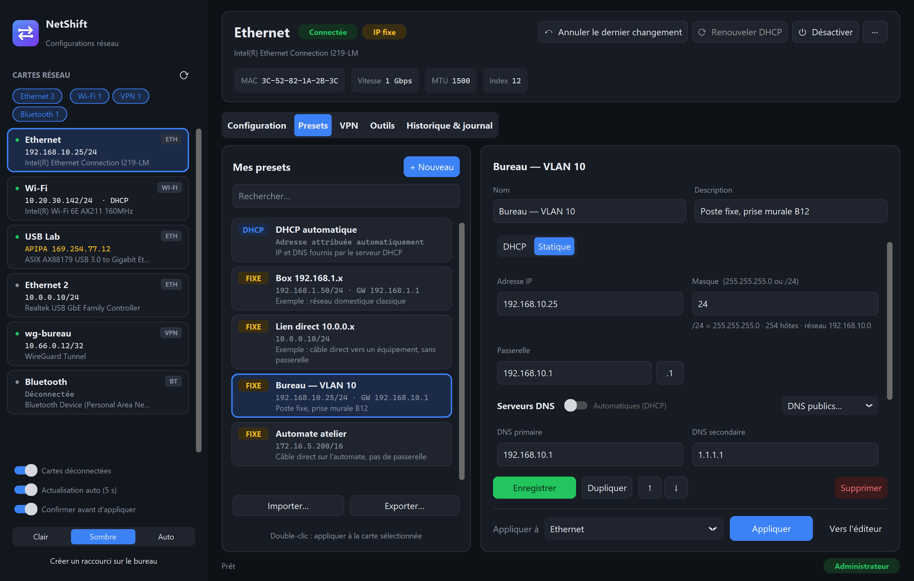
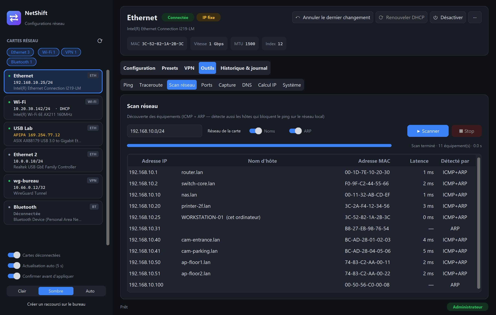
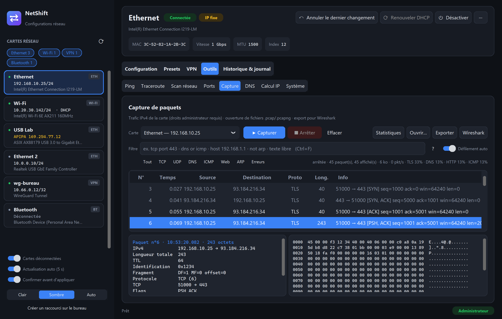
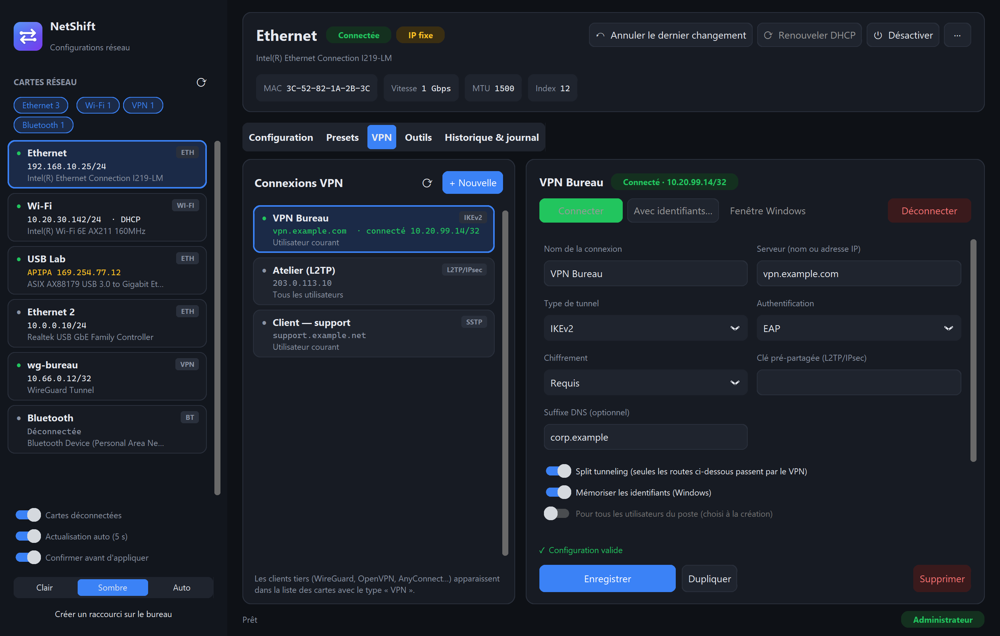

<div align="center">


# NetShift

**A clean, modern Windows app to switch network adapter IP configurations in one click,
with presets, undo, and the network tools you reach for every day.**

[](https://github.com/neoguiri/netshift/actions/workflows/ci.yml)
[](https://github.com/neoguiri/netshift/releases/latest)
[](LICENSE)


[Download](https://github.com/neoguiri/netshift/releases/latest) ·
[Features](#features) ·
[Screenshots](#screenshots) ·
[FAQ](#faq) ·
[Version française](README.fr.md)



</div>

---

If you regularly plug your laptop into different networks — a lab bench, a switch you are configuring,
a PLC, a camera in factory-default `192.168.0.x`, then back to the office DHCP — you know the
`ncpa.cpl` → *Properties* → *IPv4* → *Properties* dance. NetShift replaces it with a single window:
pick a card, pick a preset, apply. Every change is recorded so you can roll back instantly.

> **Note** — the user interface is currently in **French**. Translating it is the top item on the
> [roadmap](#roadmap); contributions are welcome.

## Features

**Network adapters**
- Live list of every adapter with link state (connected, cable unplugged, disabled), IP, DHCP/static, APIPA detection
- Adapters are classified (Ethernet, Wi-Fi, VPN, Bluetooth, mobile, virtual) — show or hide each type with one click
- Auto-refresh every 5 s: plugging a cable or getting a new lease shows up immediately and is logged
- Enable / disable, rename, change MTU, renew / release DHCP — per adapter

**Configuration**
- Side-by-side *current* vs *new* configuration; click any current value to copy it
- DHCP or static, mask as `255.255.255.0` **or** `/24`, one-click `.1` gateway, secondary IPs
- Manual DNS even in DHCP mode, public DNS shortcuts (Cloudflare, Google, Quad9, OpenDNS)
- Live validation: network/broadcast address, gateway outside subnet, malformed entries…
- Confirmation dialog summarising the change, then an automatic gateway ping to verify it worked

**Presets**
- Create, edit, duplicate, reorder, search; free-text notes (site, device, VLAN…)
- Apply any preset to any adapter; double-click applies it to the selected one
- Import / export as JSON to share with your team

**VPN**
- Lists the Windows VPN connections (current user and all users) with live status and assigned IP
- Create, edit, duplicate, rename and delete: server, tunnel type (IKEv2, SSTP, L2TP/IPsec, PPTP, automatic),
  authentication, encryption, L2TP pre-shared key, DNS suffix, split tunneling with its routes
- Connect with saved credentials, with credentials typed for this connection only, or through the Windows dialog;
  disconnect; readable explanations for the common `rasdial` errors (691, 800, 809…)
- Third-party clients (WireGuard, OpenVPN, AnyConnect, FortiClient…) appear in the adapter list as *VPN*

**History & undo**
- Every applied change stores the previous configuration
- *Undo last change*, *Restore previous* or *Re-apply* from the history; exportable activity log

**Network tools** (no console windows, all native)
- **Ping** — count or continuous, live loss / min / avg / max
- **Traceroute** — ICMP with optional reverse DNS
- **Network scan** — ICMP **and** ARP, so it also finds hosts that block ping on the local subnet;
  right-click a host to ping, port-scan, open `http(s)://`, RDP or browse its shares
- **TCP port check** — lists (web, Windows, common) or ranges up to the full 1–65535
- **Packet capture** — live IPv4 capture on the chosen adapter (TCP, UDP, ICMP, DNS, HTTP, TLS…),
  Wireshark-style display filters (`tcp port 443`, `dns or icmp`, `host 10.0.0.1 not port 22`…),
  one-click quick filters, packet details + hexdump, conversation / host / protocol statistics,
  open existing `.pcap` / `.pcapng` files (Ethernet, VLAN, ARP, IPv6), export to `.pcap`, and
  **Open in Wireshark** already capturing on the selected adapter
- **DNS** — resolve, reverse lookup, `nslookup` against a specific server, flush cache
- **Subnet calculator** — network, broadcast, host range, wildcard, binary; public IP lookup
- **System** — `ipconfig /all`, ARP table, routing table, active connections, Wi-Fi profiles…

## Screenshots

| Presets | Network scan |
|---|---|
|  |  |
| **Packet capture** | **VPN** |
|  |  |

Light and dark themes (or follow Windows). More in [`docs/screenshots`](docs/screenshots).

## Installation

### Option 1 — installer (recommended)

Download `NetShift-Setup-x.y.z.exe` from the [latest release](https://github.com/neoguiri/netshift/releases/latest)
and run it: Start-menu shortcut, optional desktop shortcut, clean uninstaller (*Settings → Apps*).
Presets and history live in `%APPDATA%\NetShift` and survive updates and uninstalls.

### Option 2 — portable executable

Download `NetShift.exe` from the same release and run it — no installation, no Python. Presets are stored
in a `data` folder next to the executable, so it works from a USB stick.

Both ask for administrator rights at start-up (required to change IP settings). `SHA256SUMS.txt` lists
the checksums of the release files.

### Option 3 — from source

Requires Windows 10/11 and [Python 3.9+](https://www.python.org/downloads/) (tick *Add to PATH*).

```bat
git clone https://github.com/neoguiri/netshift.git
cd netshift
"Lancer NetShift.bat"
```

The launcher installs the only dependency ([CustomTkinter](https://github.com/TomSchimansky/CustomTkinter))
on first run, then starts the app. Or manually:

```bat
pip install -r requirements.txt
pythonw NetShift.pyw
```

Use the *Créer un raccourci sur le bureau* button in the sidebar to add a desktop shortcut.

### Build the executable yourself

```bat
build_exe.bat
```

Produces `dist\NetShift.exe` with PyInstaller, and `dist\NetShift-Setup-<version>.exe` if
[Inno Setup 6](https://jrsoftware.org/isdl.php) is installed (script: `installer/netshift.iss`).

## Usage

| Action | How |
|---|---|
| Apply a configuration | Select an adapter → edit *Nouvelle configuration* → **Appliquer** (or `Ctrl+Enter`) |
| Start from current settings | *Copier dans l'éditeur →* |
| Save as preset | *Enregistrer comme preset* (from the editor or the current config) |
| Apply a preset | *Presets* tab → choose target adapter → **Appliquer**, or double-click the preset |
| Roll back | **Annuler le dernier changement** in the header, or *Historique & journal* |
| Refresh adapters | `F5` or ⟳ |

Without administrator rights the app opens in **read-only mode**: everything is visible, the tools work,
and a banner offers to relaunch elevated.

## How it works

- **Reading** adapters uses PowerShell (`Get-NetAdapter`, `Get-NetIPAddress`, `Get-NetRoute`,
  `Get-DnsClientServerAddress`) through one persistent, hidden PowerShell process: the first read takes
  about 3 s, subsequent refreshes about 0.25 s.
- **Applying** uses the standard `netsh interface ipv4` commands, addressed by interface index
  (robust to localized or non-ASCII adapter names). The exact commands are shown in the log.
- **Packet capture** uses a raw socket in promiscuous-receive mode (`SIO_RCVALL`, admin rights): no driver to
  install, IPv4 only. For a full capture (Ethernet, ARP, VLAN, Wi-Fi), the *Wireshark* button launches
  Wireshark/Npcap on the selected adapter.
- **Ping, traceroute and ARP** call the Windows IP Helper API (`IcmpSendEcho`, `SendARP`) via `ctypes`:
  fast, no console windows, no raw sockets, no admin rights needed.
- **No telemetry, no network calls** except the ones you trigger (the public-IP button queries
  `api.ipify.org`).

More details in [docs/ARCHITECTURE.md](docs/ARCHITECTURE.md).

## Data

Stored as plain JSON — in `%APPDATA%\NetShift` for the installed version, in `data/` next to the app for the
portable version and source checkouts (falling back to `%APPDATA%\NetShift` if that folder is not writable):

| File | Content |
|---|---|
| `presets.json` | Your presets (portable — share it or use Import/Export) |
| `history.json` | Last 50 applied changes with their previous state |
| `settings.json` | Theme, window size, options |

## FAQ

**Why does it need administrator rights?**
Changing IP, DNS or adapter state is a privileged operation in Windows. Read-only use and the tools
do not need elevation.

**Windows SmartScreen / my antivirus warns about the .exe.**
The executable is built by GitHub Actions with PyInstaller and is not code-signed; unsigned PyInstaller
apps are sometimes flagged. You can check the build log of the release, or run from source.

**Is IPv6 supported?**
Not yet for configuration (IPv6 addresses are left untouched). See the roadmap.

**Can I manage Wi-Fi adapters?**
Yes — any adapter listed by `Get-NetAdapter` (Ethernet, Wi-Fi, USB, virtual).

## Roadmap

- [x] Packet capture with filters, statistics, `.pcap`/`.pcapng` import/export and Wireshark launch (1.1)
- [x] Windows installer (1.1)
- [x] **VPN management** (1.2): list, create, edit, delete, connect / disconnect Windows VPN connections
- [x] Show / hide adapters by type (1.2)
- [ ] English interface / i18n
- [ ] IPv6 configuration
- [ ] Per-preset target adapter and quick-switch from the system tray
- [ ] Custom DNS suffix, WINS, interface metric
- [ ] MAC vendor lookup in the network scan
- [ ] Code-signed release builds

Ideas and votes welcome in [issues](https://github.com/neoguiri/netshift/issues).

## Contributing

Bug reports, feature requests and pull requests are welcome — see [CONTRIBUTING.md](CONTRIBUTING.md).
Please follow the [Code of Conduct](CODE_OF_CONDUCT.md). Security issues: see [SECURITY.md](SECURITY.md).

## License

[MIT](LICENSE) © neoguiri
